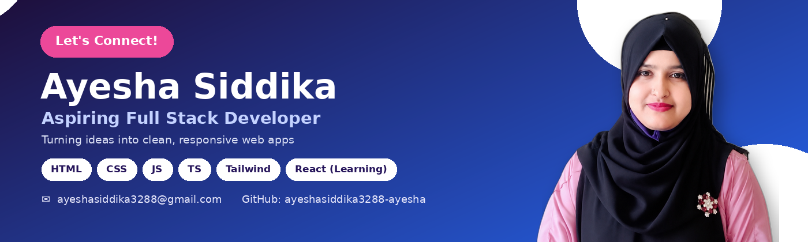

# Hi 👋, I'm Ayesha Siddika

### Aspiring Full Stack Developer

---

### 👩‍💻 About Me

Hi! I'm Ayesha Siddika, an aspiring Full Stack Developer passionate about building modern, responsive, and user-friendly web applications. I enjoy solving problems, exploring new technologies, and turning ideas into practical solutions.

I'm continuously improving my development skills through hands-on projects, academic work, and collaborative development.

- 🎓 Diploma in Computer Science and Technology (Completed)
- 🎓 Currently pursuing BSc in Computer Science and Engineering (8th of 9 semesters)
- 🎯 Goal: Becoming a professional Full Stack Developer
- 🧠 Passionate about problem-solving and continuous learning
- 📍 Based in Uttara, Dhaka, Bangladesh

---

### 🚀 Currently Working On

- 🐝 Developing **NearBee** – a Hyperlocal Community Service Platform (Final Year Project).
- 🤖 Working on **ShopPilot AI** – an AI-Powered Social-Commerce Management Platform (Software Development 3 Project).
- 🌱 Exploring Next.js and modern web development.
- 💻 Building applications with JavaScript, TypeScript, React, and Next.js.
- 🎨 Creating responsive user interfaces with Tailwind CSS.
- 🍃 Working with Node.js, Express.js, and MongoDB.
- 🤝 Collaborating on university team projects.

---

### 🛠️ Technology Stack

**Programming Languages**

**Frontend Development**

**Backend & Database**

**Tools & Technologies**

---

### 📊 GitHub Statistics

### 🔥 GitHub Streak

---

### 📌 Featured Projects

Check out my pinned repositories below 👇

---

### 📫 Connect With Me

- 📧 Email: ayeshasiddika3288@gmail.com
- 📍 Location: Uttara, Dhaka, Bangladesh
- 💼 LinkedIn: [Ayesha Siddika](https://www.linkedin.com/in/ayesha-siddika-cse)
- 🌐 Portfolio: [Visit My Portfolio](https://ayesha-portfolio-b5ww.vercel.app/)

---

⭐ Thanks for visiting my profile!

